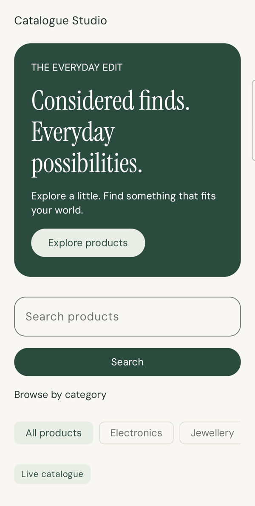
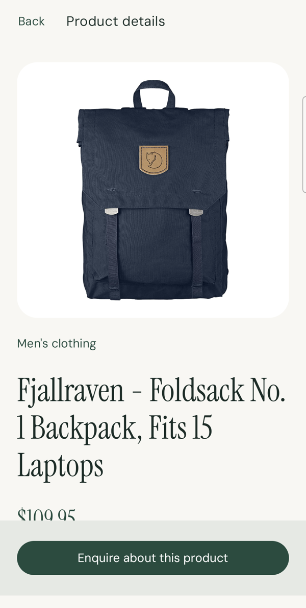
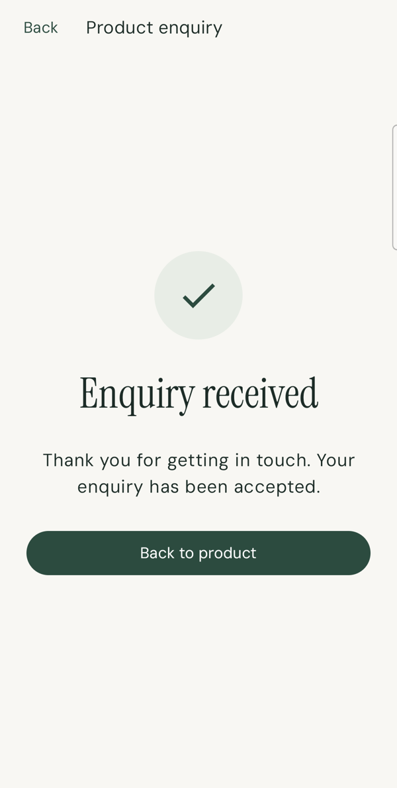

# Catalogue Studio

A Kotlin / Jetpack Compose Android catalogue with a local TypeScript / Node.js backend. Browse featured products, filter categories, explicitly submit a search, view product details and send an enquiry to a local sales inbox.

Android matches the author's existing expertise, keeping the challenge focused on product/API boundaries and AI-assisted judgement. Node.js with TypeScript keeps HTTP, validation and email wiring small. One repository contains both deployable components and local infrastructure so reviewers can run a matching version together.

## Run locally (Android Emulator)

You need **Docker Desktop running**, **Android Studio**, a full **JDK 17**, **Android SDK 36 / Build Tools 36.0.0**, and an **API 26+ emulator**. No paid account or API key is needed. Initial tool/download installation is outside the quick-start estimate; a clean setup has not been timed.

1. Clone the repository and select the PR branch:

   ```sh
   git clone https://github.com/mohnish777/catalogue-studio.git
   cd catalogue-studio
   git switch feature/catalogue-step-by-step
   ```

   For a private repository, sign in with the Git account granted reviewer access first.

2. Start the local backend and email inbox using live Fake Store products:

   ```sh
   docker compose up --build -d --wait
   ```

   Live Fake Store products are the default; keep an internet connection available. This command works in macOS/Linux shells and Windows PowerShell.

3. Open **android/** in Android Studio. Set **Gradle JDK to 17**, sync, select **app** and run on the emulator. The default URL `http://10.0.2.2:3000` connects it to your computer's backend. Keep Docker running while reviewing.
4. Browse → open a product → **Enquire** → enter a name, `review@example.test` and an optional message → **Send enquiry**. Expect **Enquiry received**. Open [Mailpit on your computer](http://127.0.0.1:8025) to see the product/contact email. Mailpit captures locally; it does not send to a real mailbox.

Stop the services when finished: `docker compose stop`.

**If the catalogue cannot load:** check Docker is running and [backend health](http://127.0.0.1:3000/health) responds. Fake Store needs internet; if unavailable, explicitly switch to bundled samples with `PRODUCT_SOURCE=demo docker compose up --build -d --wait`. The app then labels them **Demo catalogue**. There is no silent fallback. On PowerShell, set `$env:PRODUCT_SOURCE="demo"` before the Compose command.

**If port 3000 is busy:** stop the other backend using it, then repeat step 2. Avoid running the Docker backend and the direct development server together on that port.

## Run on a physical Android phone

The backend still runs on your **computer**. An APK alone does not include it.

1. Complete steps 1–2 above. Connect an Android API 26+ phone by USB, enable **Developer options → USB debugging**, and accept the phone's authorisation prompt.
2. In `android/local.properties`, add the following line while keeping Android Studio's existing `sdk.dir`:

   ```properties
   apiBaseUrl=http://127.0.0.1:3000
   ```

3. With Android SDK platform-tools on your PATH, run:

   ```sh
   adb devices
   adb -s YOUR_SERIAL reverse tcp:3000 tcp:3000
   ```

   Replace `YOUR_SERIAL` with the connected phone's serial from `adb devices`. If adb is missing, use Android Studio's SDK Manager to install Android SDK Platform-Tools and add its platform-tools folder to PATH.
4. Select that phone in Android Studio and Run. Inspect received mail in your **computer's browser** at [Mailpit](http://127.0.0.1:8025).

Reapply the reverse command after reconnecting USB. Rebuild after changing the URL. `local.properties` is ignored by Git, so teammates keep the emulator default. When switching your own setup back to an emulator, remove the apiBaseUrl line and rebuild. Plain HTTP is debug-only; deployed releases require HTTPS and signing.

**Reviewing the PR from a phone browser?** You can inspect screenshots and download/play the walkthrough below. Running the app requires an Android phone plus the computer/backend setup above. An iPhone can review the media but cannot install this Android app. Localhost links point to the device opening them; Mailpit and backend health links are intended for the computer running Docker.

## Backend development without a backend container

From the repository root, with nvm installed:

```sh
nvm install
nvm use
docker compose up -d mailpit
npm --prefix backend ci
npm --prefix backend run dev
```

Use either this direct server or the Compose backend on port 3000. Node 22 is selected by `.nvmrc`; JDK 17 is pinned for the Gradle daemon. Copy `backend/.env.example` to `backend/.env` only when overriding the documented defaults. Credentials belong there or in deployment environment variables, never in source control.

Default `PRODUCT_SOURCE=live` fetches real Fake Store products through our backend. For repeatable samples, explicitly start with `PRODUCT_SOURCE=demo npm --prefix backend run dev`, or `PRODUCT_SOURCE=demo docker compose up --build -d --wait`; the app then displays Demo catalogue. Live failures remain errors; there is no silent demo fallback. The default quick start above uses Fake Store. Live backend catalogue and image access were verified on 7 November 2026; the earlier regression walkthrough uses demo fixtures for repeatability.

## Checks and CI

From the root after installing backend dependencies and starting Mailpit:

```sh
RUN_SMTP_TEST=1 npm --prefix backend test
./android/gradlew -p android :app:testDebugUnitTest :app:assembleDebug :app:assembleRelease :app:lintDebug
```

Without `RUN_SMTP_TEST=1`, the optional SMTP integration test skips. Tests otherwise use controlled fakes and local HTTP servers, without a live provider account. Latest Slice 15 evidence: **91 Android tests / 46 backend tests passed**, debug and unsigned release builds passed, lint **0 errors / 26 warnings**. See [verification evidence and limits](docs/VERIFICATION.md).

For the repeatable automated walkthrough, first restart the backend with explicit `PRODUCT_SOURCE=demo`. This script expects the bundled fixtures (unlocked test device, Node 22, backend on 3000, Mailpit running):

```sh
./android/gradlew -p android :app:assembleDebug -PapiBaseUrl=http://127.0.0.1:3000
adb -s YOUR_SERIAL install -r android/app/build/outputs/apk/debug/app-debug.apk
python3 scripts/smoke-android.py --serial YOUR_SERIAL --smtp-failure --output /tmp/catalogue-smoke
```

This restarts the selected app and uses synthetic contact data. It checks validation, SMTP failure with retained form, process restoration without auto-send, explicit retry, captured email and confirmation/Back. It owns a temporary failure backend and restores USB forwarding; normal backend/Mailpit stay running. Screenshots are saved to the selected output directory. It assumes current English labels and demo fixtures.

[GitHub Actions](.github/workflows/verify.yml) runs backend typecheck/build/tests with a Mailpit service and Android JVM tests/build/lint on pushes and PRs into main. Android report artifacts are retained for seven days. It does not run the device smoke or verify live-provider access. Hosted results remain pending until the author pushes; local passing checks do not establish hosted success.

## Screenshots and video

Actual API 36 phone captures. Live catalogue/detail/confirmation media uses Fake Store through the local backend; the failure screenshot uses the repeatable demo setup. All enquiry contacts are synthetic.

| Catalogue | Product details | Confirmation |
| --- | --- | --- |
|  |  |  |

[Retained form after SMTP failure](docs/screenshots/retained-form.png).

[Download the actual app walkthrough](docs/media/catalogue-walkthrough.mp4): live catalogue → product details → form validation → enquiry → confirmation. For inline playback in the PR, attach the MP4 in GitHub’s description editor.

## Architecture and review map

```text
android/   Single :app module; domain → contracts/models/validation,
           data → Ktor/DTOs/error mapping, presentation → state/ViewModels,
           ui → Compose screens/theme, Koin + typed navigation wiring.
backend/   Express routes → product source/catalogue rules and SMTP mailer.
           fixtures + images for explicit demo mode; live provider adapter.
compose.yaml   Backend + local Mailpit, loopback-published ports.
docs/      Verification, slice plan, implementation history, assets and PR draft.
```

Runtime: Compose action → ViewModel → data-source interface → Ktor → local backend → selected product source or mailer → typed result → state → UI. Navigation passes product IDs; the backend owns product selection/ranking/search. Enquiry success requires SMTP acceptance; a failed request preserves fields. There is no database or automatic POST retry. Mailpit capture is not external delivery or an exactly-once guarantee.

- [Decisions, assumptions and next-day priorities](DECISIONS.md)
- [AI usage, mistakes and actual-time record](AI_USAGE.md)
- [Slice plan and review status](docs/PLAN.md)
- [Verification](docs/VERIFICATION.md) and [asset attribution](docs/ASSETS.md)
- [Chronological code review notes](docs/IMPLEMENTATION_NOTES.md)
- [PDF requirement audit](docs/SUBMISSION_CHECKLIST.md)
- [PR description draft and author handoff](docs/PR_DESCRIPTION.md)

The author owns commits, pushes and an open feature-branch PR into `main`. The author confirmed approximately nine hours total (planning 1 hour, building 5 hours, testing/debugging 1.5 hours and reviewing 1.5 hours) and Codex as the only AI tool used. Before submission, review the code/draft, verify hosted CI after pushing and grant reviewer access if the repository is private.
