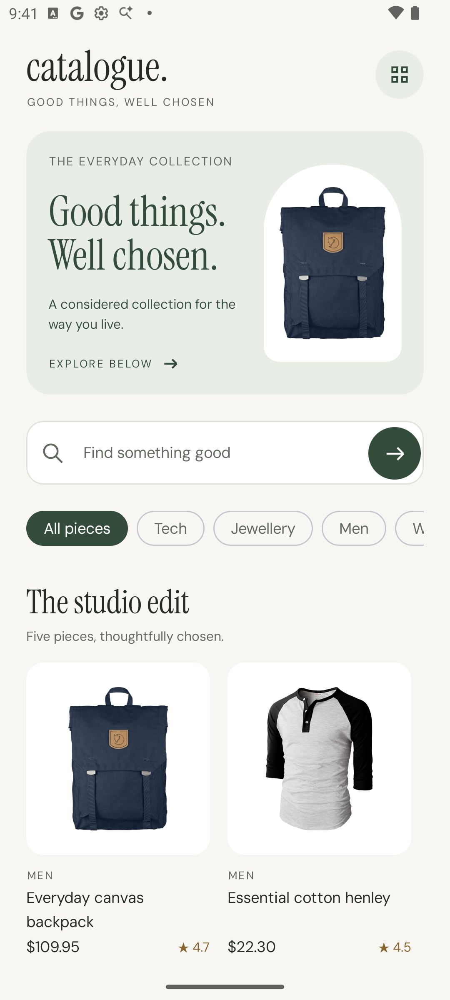
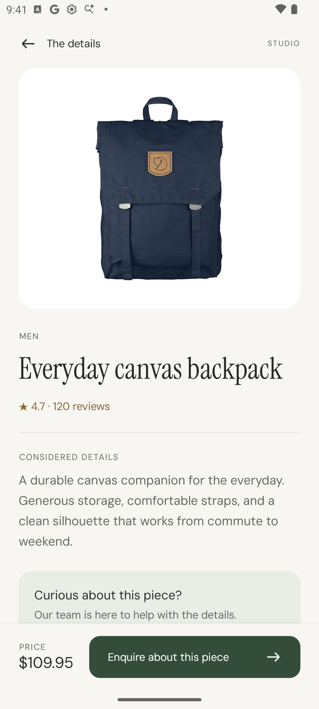
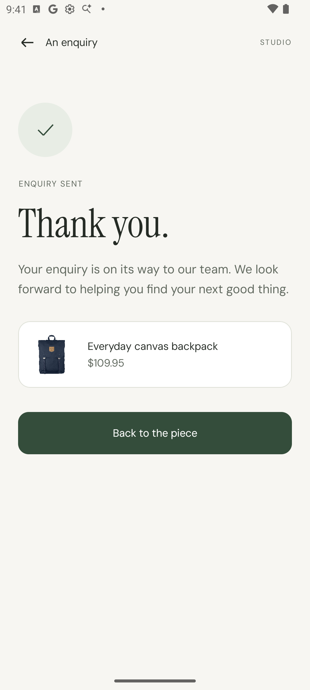

# Catalogue Studio

A considered collection for the way you live. An Android product catalogue built with Kotlin and Jetpack Compose, backed by a small TypeScript service.

Browse five editorial picks, explore categories, search product titles and descriptions, inspect a piece, and send an enquiry to a local sales inbox.

<p>
  
  
  
</p>

## Run locally

Prerequisites: Docker Desktop with Compose, Android Studio with Android SDK 36 and an Android Emulator (API 26+), and JDK 17+. Android Studio's bundled JDK works. No paid service, email account, API key, or database is needed. Initial SDK installation is a prerequisite; with the tooling installed, the intended setup takes under ten minutes, subject to download speed.

**1. Start the backend and local inbox from the repository root:**

```sh
docker compose up --build -d
```

Check [backend health](http://localhost:3000/health) and open the [sales inbox](http://localhost:8025). The health response reports the active product source.

**2. Open `android/` in Android Studio**, sync Gradle, start an emulator, and run the `app` configuration. Alternatively, with an emulator already running and `ANDROID_HOME` pointing to your SDK:

```sh
cd android
./gradlew installDebug
adb shell am start -n com.cataloguestudio/.MainActivity
```

The debug app connects to `http://10.0.2.2:3000`, the Android Emulator's address for your computer. Cleartext HTTP is permitted only in the debug manifest. A production build needs an HTTPS backend. For a different host, build with `-PapiBaseUrl=https://your-host.example` (or use your computer's LAN address for a debug build on a physical device).

Submit an enquiry with sample contact details. Its email appears in Mailpit; the app shows a thank-you only after SMTP accepts it. Mailpit captures mail locally and does **not** deliver it to an external mailbox.

Stop the local services with `docker compose down`. Captured mail is disposable and is not backed by a persistent volume.

## Demo data and Fake Store API

The default is **explicit demo mode**: thirteen bundled sample products, four categories, and locally served product images. Live Fake Store API requests returned an HTTP 403 Cloudflare challenge during this build, so the reviewer should not have to depend on that endpoint to see the app working. The sample copy and ratings are illustrative.

The live integration is implemented separately and can be enabled without changing the app:

```sh
PRODUCT_SOURCE=live docker compose up -d --force-recreate backend
```

Switch back with `PRODUCT_SOURCE=demo docker compose up -d --force-recreate backend`. Live mode validates and maps the upstream API response and caches successful catalogue responses for sixty seconds. It never silently substitutes demo data; provider failures produce an error with retry. The Android app receives all product data **and images** through our backend.

## Verify

Node 22+ is needed only when running the backend directly or running its tests. With nvm, use `nvm install && nvm use` from the repository root.

```sh
cd backend
npm ci
npm run format:check
npm run typecheck
npm test
npm run build
# With Mailpit running on localhost:1025 and localhost:8025:
RUN_SMTP_TEST=1 npm test
```

```sh
cd android
./gradlew assembleDebug testDebugUnitTest lintDebug --console=plain
```

Backend tests cover editorial picks, category ranking, title/description search, image delivery, input validation, rate limiting, upstream errors, and SMTP failure. Android unit tests cover all three ViewModels, cancellation of stale searches, validation, navigation, saved form state, failed submissions, and duplicate taps. The optional SMTP test verifies an actual captured email.

A repeatable emulator smoke test exercises category/search/detail/form/confirmation and checks the received email. Run it from the repository root with the debug app installed, services running in demo mode, and a disposable emulator. The optional flag briefly stops and restarts **this project's Mailpit service** to verify form recovery:

```sh
python3 scripts/smoke-android.py --serial emulator-5554 --smtp-failure
```

This writes real emulator screenshots to `docs/screenshots/`. GitHub Actions runs backend checks (including local SMTP) and Android build/unit tests/lint. It does not run the emulator smoke script.

## Structure and configuration

```text
android/                  One app module; domain, data, presentation, ui packages
backend/src/catalogue.ts  Product-source boundary and catalogue selection
backend/src/mail.ts       Enquiry validation and replaceable SMTP delivery
backend/src/app.ts        HTTP routes and error handling
compose.yaml              Local backend and Mailpit
```

Kotlin/Compose uses the author's Android expertise. Node.js/TypeScript is one of the challenge's permitted backend stacks and keeps the server small. Android uses Ktor, Koin, StateFlow/MVI, type-safe Navigation Compose, and Coil. Product DTOs are mapped to domain models; ViewModels depend on a domain data-source interface, not HTTP or Compose.

For backend development without a backend container, start only `docker compose up -d mailpit`, then run `npm ci`, copy `.env.example` to `.env`, and run `npm run dev` from `backend/`. See `backend/.env.example` for port, source, and SMTP settings. To deliver externally later, configure a real SMTP server and sales address in your environment. Do not commit credentials.

HTTP interfaces:

- `GET /health` — service status and product-source mode.
- `GET /api/catalogue?category=...&search=...` — categories, featured picks, and remaining products; filters combine.
- `GET /api/products/:id` — one product; unknown IDs return 404.
- `GET /api/products/:id/image` — backend-served product image.
- `POST /api/enquiries` — `{ productId, name, email, message }`; returns 201 only after SMTP acceptance. Validation errors return 400, unknown products 404, rate limiting 429, and mail failures 503.

See [decisions and assumptions](DECISIONS.md), [AI usage](AI_USAGE.md), [the six-hour plan](docs/PLAN.md), [verification and time spent](docs/VERIFICATION.md), and [asset attribution](docs/ASSETS.md).
